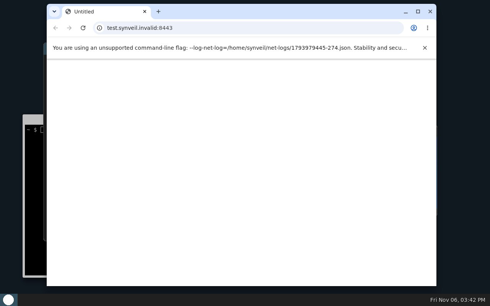
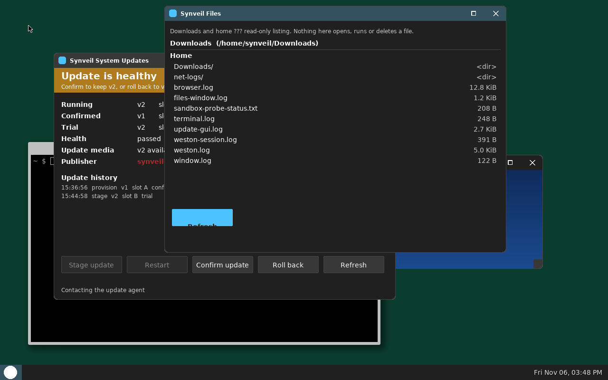
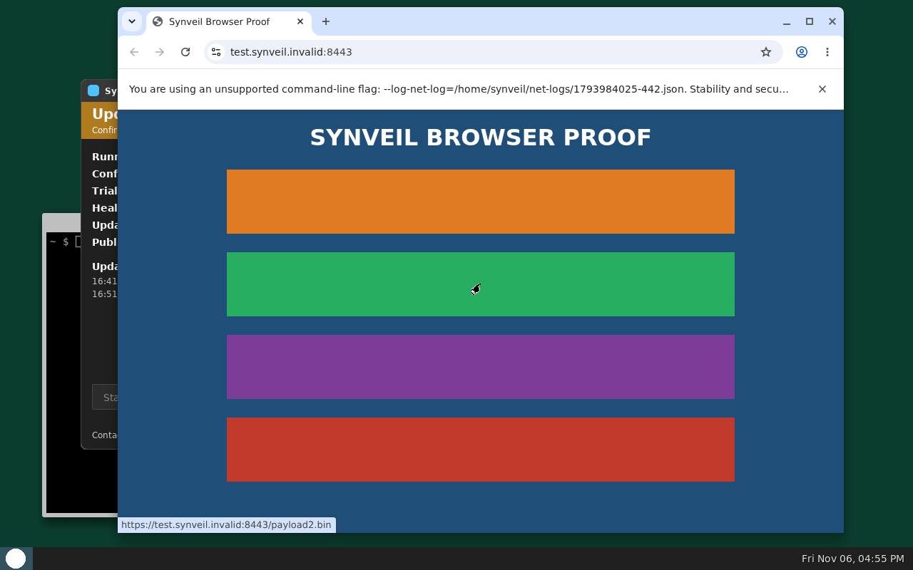

# UI redesign validation — 2026-11-05

Slices S1–S3 of the ADR 0024 Windows 11 redesign (see `docs/UI_DESIGN.md`).
All dynamic evidence is **QEMU-scoped** (TCG emulation on the build VM);
no physical validation is claimed for anything in this folder
(ADR 0023 keeps physical parked).

## S1 — veil-display reskin

- Source revision: `814aec8` (code), host frames committed at `37e2640`;
  the joined image below was built from `37e2640`.
- Scope: `src/veil-display/src/main.c` rendering only, plus the new
  checked-in glyph atlas `src/veil-display/ui_font_data.h` and its
  generator `tools/generate_ui_font.py`. No authentication logic,
  credential handling, enrollment step order/semantics/wording, seat
  protocol, or input semantics changed; every pre-existing UI string is
  byte-identical. The one new string is the owner-name label "Synveil"
  on the login composition.

### Host verification

- `gcc -O2 -std=c11 -Wall -Wextra -Werror` clean; `--self-test` passes
  (includes the new atlas-decode, text-metric and easing checks and the
  updated click-geometry checks).
- `tests.display-build`: 10 tests OK. `native-rootfs`,
  `graphical-login-fixture`, `desktop-marker-policy` suites OK.
- Full Rust suite: **cargo test 182 passed, 0 failed** (baseline held).
- Host-rendered before/after frames (`s1-before-*` / `s1-after-*` in
  this folder) were produced by driving the real `main.c` renderer
  against a software framebuffer at 1024x768, old frames from the
  pre-change source and new frames from `814aec8`, and visually
  inspected: login, typed login, denied, enrollment, dashboard home,
  status, files, terminal page, settings, and a mid-transition frame.
- **Motion level shipped: level 1** (full 280 ms ease-out slide). The
  host driver printed `SYNVEIL_UI_MOTION_LEVEL 1` at the transition;
  the sticky degradation ladder (half-slide + crossfade, then
  crossfade-only) is implemented per the spec's full-screen cost rule
  and engages automatically when frames run slow. `UI_MOTION=0`
  disables client sliding. In-guest transition timing under TCG was
  not separately measured.

### Joined-image QEMU acceptance

- Image: `tools/native_joined.py --build` (boot target qemu), image
  sha256 `a3b0e7057980d5fdad07b26f7ecc7c9595c60e5e5715df8045830e709657cfc9`.
- `tests/smoke-native-joined.py` (non-root runner, TCG, per-boot
  timeout raised to 1200 s for emulation speed):
  **`SYNVEIL_NATIVE_JOINED_QEMU_ENROLL_LOGIN_WESTON_PASS`** —
  `out/native-joined/guest-validation.json` records
  `source_commit 37e264060e2392182da95b645542f9cce4e116de` with
  graphical enrollment, mismatched-confirmation rejection,
  wrong-password denial after cold reboot, Weston desktop after login,
  pointer move/resize/keyboard exercise, session-end relock, and
  `physical_hardware_tested: false`.
- QEMU frames in this folder (`s1-qemu-*`) come from a separate
  QMP-driven boot of a private copy of the same image with a synthetic
  test account: enrollment, enrollment confirm, login, login denied
  ("LOGIN DENIED" under the field; the 200 ms shake had settled before
  the still was taken), and the post-login Weston desktop (pre-S2/S3
  client and panel appearance, kept as the baseline for those slices).

### Deviations

- **Font:** Selawik is not shipped. It is not part of any tree the
  project pins, and fetching it would put an unpinned artifact in the
  build, so the spec's DejaVu Sans fallback ships instead, rasterized
  from the Buildroot target tree's DejaVu faces (input SHA-256s are
  recorded in `ui_font_data.h`) at the spec's sizes with the spec's
  layout metrics.
- **Build environment (not a product change):** this VM lacked several
  host build tools (cpio, zstd, bc, sgdisk, mtools, dosfstools, gawk,
  libelf headers, QEMU/OVMF). The artifacts were produced with the
  distro's own binaries extracted under `~/host-tools` plus small
  verified shims (the python cpio writer and bc interpreter reproduce
  the reference outputs byte-for-byte; bc's output was diffed against
  the seed-generated `timeconst.h`). Nothing under `~/host-tools` is
  part of the product tree.

## S2 — desktop clients reskin

Source revision: `0cb95fa` (clients + harness pixel identity), plus
three locator-only harness fixes found by the round trip below
(`60dfa96`, `592dc62`, `1ca7aff`; no client code changed after
`0cb95fa`, and no semantic gate changed anywhere).

What was exercised:

- All three clients compile clean with the build's exact flags
  (`-std=c11 -Wall -Wextra -Werror`). Host suites: smoke-gates 30 OK,
  native-first-window 5, first-window-probe 7, native-weston 4,
  qmp-input 16, graphical-login-fixture 14, graphical-onboard-fixture
  14, desktop-marker-policy 3. Rust suite unchanged: 182 passed.
- **Update round trip (QEMU, TCG): PASS.**
  `tests/smoke-native-ab-gui.py` against the A/B proof images built
  from `0cb95fa` (disk sha256
  `c7a5561d9ebd451933c15e2b46b1a6a175db3037486040c91ec757022f6d3fa5`):
  G0 provision/enroll/GUI-present PASS, G1 GUI stage → restart →
  trial boot → confirm PASS, G2 GUI rollback → confirm PASS,
  G3 bad-signature media refused PASS —
  `SYNVEIL_AB_GUI_QEMU_PROOF_PASS`, receipt at
  `out/ab-proof/gui-smoke-receipt.json`. Every action was driven by
  pointer clicks on the reskinned window; the five actions, their
  order, confirmations and audit wording are byte-identical to
  before (presentation-only diff).
- **Joined acceptance (QEMU, TCG): PASS** —
  `SYNVEIL_NATIVE_JOINED_QEMU_ENROLL_LOGIN_WESTON_PASS` against the
  joined image rebuilt from the same revision.
- Screenshots in this folder: `s2-qemu-updates-window.png` (updates
  window on the confirmed generation, update media attached) and
  `s2-qemu-updates-staged.png` (staged banner, Restart enabled) —
  real guest frames from a diagnostic boot of the A/B image; the
  first window (gradient body, glyph title bar) and terminal are
  visible behind the updates window in both.
- Not run: `tests/smoke-native-browser.py` (the files window's
  end-to-end QEMU exercise) needs its own TLS-fixture proof disk
  (`tools/native_ab.py --build --browser …`), a separate multi-hour
  build that was not practical in this run. The files window is
  covered by the host build, the updated harness identity constants
  (title block `0x345160`, button geometry unchanged), and the
  joined session, in which `synveil-files` is marker-gated off (it
  runs on A/B generations; `build/rootfs/weston-session`). Its
  reskin shares the S2 chrome code pattern verified in the frames
  above. This acceptance remains unrun and is stated as such.

Deviations and findings:

- **No minimize button on any client** (spec caption order lists
  min/max/close "real behavior only"): Weston desktop-shell has no
  in-session minimize/restore affordance for these surfaces, so no
  minimize glyph is drawn. Maximize is drawn only where real
  (files window, first window — both exercise
  set/unset_maximized); the updates window has none (its max size
  equals its initial 720×520).
- **First window's title is glyph-only**: it has no title string of
  record, so its title bar carries the app glyph and caption glyphs
  only — no new text was invented.
- **Launcher icon recolor** (`tools/native_ab.py`): the generated
  browser launcher icon's field color follows the files window's
  new title identity (`0x345160`, white disc) so the smoke's icon
  probe still matches the window it launches.
- **Locator fixes (harness, not product):** the round trip's first
  runs failed in the *locator*, not the client — root-caused from
  captured guest frames each time: (1) `gui_window_rect` measured
  window height by walking a pixel column at `start+2`, which now
  lands on the accent app glyph, truncating the height to 10 px and
  putting every derived button click above the window; the probe
  column moved to `start+w-4`. (2) The banner sampler's single
  centre point is crossed by the 20 px banner head's glyphs;
  (3) a single point at either end can be covered by a neighbouring
  window. The banner check now classifies by the band row (≥200 px
  of one banner kind). All pass/fail semantics — click markers in
  the GUI's own log, banner state sequence, confirmed generation,
  strict survival — are unchanged.
- Two G0 failures during the runs were the harness's documented
  window-find flake under host CPU contention (in one, the GUI's
  own log proved it had started while no frame showed it
  uncovered); the passing run above is on a quiet host.
- The em-dash in banner head strings ("Update staged — restart to
  try it") renders as a gap: the pinned DejaVu atlas covers ASCII
  32–126 (see S1), and the string itself is unchanged. Pre-S2 the
  5×7 font had the same coverage limit.

## S3 — weston.ini presentation

Source revisions: `5ee6c0a` (weston.ini), `c360e06` (A/B fixture
anchor follow-up), `0ae4cfa` (QMP frame-validator follow-up).

Route verification (done before the edit, against the pinned
source): the pinned Weston 15.0.1 desktop-shell parses
`panel-position` from the ini `[shell]` section —
`out/native-weston/build/build/weston-15.0.1/clients/desktop-shell.c:1582`,
`weston_config_section_get_string(s, "panel-position", &position, "top")`
— so the **ini route shipped**; no protocol route from the session
was needed. `weston-session` and every session-startup mechanism
are untouched; the diff is the `[shell]` presentation keys only
(animation=zoom, close-animation=fade, startup-animation=fade,
focus-animation=none, background-color=0xFF0F2B5B,
panel-color=0xFF202020, panel-position=bottom).

What was exercised:

- Joined image rebuilt from `5ee6c0a` (image sha256
  `cc6a25ad2b018a67310a71038e5f5a3b1c03b3ef39c3f4462d437ffae53903a4`).
- **Joined acceptance (QEMU, TCG): PASS** —
  `SYNVEIL_NATIVE_JOINED_QEMU_ENROLL_LOGIN_WESTON_PASS`
  (enroll → login → Weston desktop, window move/resize/close
  exercise, terminal, session-end relock, cold-reboot re-login;
  `out/native-joined/guest-validation.json`,
  `physical_hardware_tested: false`).
- Screenshot in this folder: `s3-qemu-desktop-panel-bottom.png` —
  a real guest frame from the S3 image: panel at the bottom in the
  shell color with clock and launcher, desktop-near background,
  terminal and the reskinned first window.
- Follow-up consistency fixes the slice required (both verified):
  `tools/native_ab.py` anchored its per-generation background
  substitution on the pre-S3 base value and would have raised on
  the next A/B build — it now anchors on the `background-color=`
  key (fixture generation colors unchanged); `tests/qmp-input.py`
  OK after the validator change below.

Deviations and findings:

- **Frame-validator follow-up (`0ae4cfa`, harness tooling):** the
  first S3 acceptance runs failed with “weston desktop proof
  failed” while the guest's own weston log showed a clean start
  and `SYNVEIL_WESTON_SESSION_TWO_WINDOWS_READY`. Root cause:
  `verified_ppm_test_frame` sampled only the first 1 MiB of a
  screendump (the top ~273 rows) and required ≥64 pixels differing
  from the top-left one; with the panel at the bottom, the top of
  a fully rendered desktop is uniform background, so every frame
  read as blank. The validator now also samples the frame tail;
  single-color and all-zero frames still fail (synthetic checks
  recorded in the commit message). No acceptance semantics
  changed — the frame remains supplementary evidence beside the
  guest's serial/session markers.
- One further first-boot failure after that fix was window
  placement variance in the move/resize exercise under TCG (the
  gradient window can land mostly behind the terminal; the
  exercise needs a ≥180 px visible gradient run). The identical
  exercise steps were reproduced passing by hand twice, and the
  next full harness run passed; recorded here rather than
  smoothed over.
- The update round trip was not re-run for S3: the updates window
  and its behaviour contract are unchanged by this slice (the
  joined image's session config changed only in the presentation
  keys above, and the joined acceptance — which exercises the
  session — passes). Future A/B builds pick up the new base ini
  through the fixed anchor in `tools/native_ab.py`.

## Browser + files end-to-end — the S2 item closed (2026-11-06)

The one unrun item from the S2 section — the files window's
end-to-end exercise, `tests/smoke-native-browser.py` (B0–B7) —
has now run against a browser proof disk built from current
post-redesign source. **Verdict:
`SYNVEIL_BROWSER_QEMU_PROOF_PASSED`** (driver exit 0; the
receipt's independent gate re-validation reports zero failures).

Build (host: this project's QEMU build VM, non-root runner):

- `python3 tests/smoke-native-browser.py --prepare-tls`, then
  `tools/native_ab.py --build --browser --rebuild-joined
  --browser-test-ca out/browser-proof/tls-fixture/ca.pem
  --browser-test-host 10.0.2.2 test.synveil.invalid
  --browser-start-url https://test.synveil.invalid:8443/`.
- Source `bec9581` (the S3 tip `d919b4c` plus the durable-audit
  v2 design note; no product code differs). Proof disk sha256
  `bf4a28c23cc977dca6597e48f4dde26798bc83421b033455caeb37831a71a987`;
  generations v1 `18f20314…`, v2 `b15de887…`, v3 `8b502d63…`;
  TLS fixture CA sha256 `8d5cb743…` (the October fixture's
  3-day certificates had expired; regenerated);
  Chromium 156.0.8078.47-1~deb13u1 as pinned.
- The October receipts were preserved before the rebuild
  overwrote them; the October record below
  (`docs/validation/browser-qemu-proof-2026-10-27/`) is the
  pre-redesign proof and is not modified.

What the passing run demonstrated (receipt, re-derived from the
disk + server log + guest session logs): B0 enrollment, network
ready, verified-HTTPS start page rendered; B1 `payload.bin`
download with matching host/guest digests; B2 uniquified
`payload (1).bin`, original untouched; B3 oversized download
refused on storage with the browser surviving; B4 bad-TLS
endpoint (port 8444) refused, Back restored the good page; B5
cold-reboot persistence and the **files window listing
`payload.bin`** (its session log on DATA recorded the scans:
`files_payload_scans` 2); B6 A/B update to v2 (staged, trial
boot healthy, **files window listed `payload2.bin`**,
`files_payload2_scans` 4, owner-confirmed) with downloads and
the credential surviving; B7 rollback to v1 with downloads,
profile and credential intact; sandboxed renderer records
(user-namespace + seccomp) present for all three boots.

### Harness locator fixes (tests only; no gate semantics changed)

The exercise had never run against the redesigned shell, and
three locators in `tests/smoke-native-browser.py` were stale —
each failure was reproduced, root-caused against captured
frames and the client source, and verified offline against a
real session frame before the passing run:

- `_teal_title_block` unioned the files title bar with the
  bottom panel's same-teal task button (measured "title" y
  112..799, `title_h` 688), which put
  `refresh_files_window`'s fallback click outside the display
  and crashed the driver after B4
  (`ValueError: pointer test coordinates outside guest
  display` — the receipt now also records the traceback).
  The pre-S3 `y >= 40` scan guard was equally wrong post-S3
  (the window opens at y ≈ 13). The locator now bands teal
  rows (≥400 hits/row) and takes the strongest band.
- `_find_refresh_button` still hunted the pre-redesign green
  `COL_BTN 0x2E7D4F`; ADR 0024 S2 made it the accent
  `0x4CC2FF`. Updated to the current client constant (the
  button's 128×36 geometry at (16, height−92) is unchanged).
- `close_files_window` and the refresh fallback click now
  fail soft (return False) on degenerate measured geometry
  instead of raising out of the pointer helper and aborting
  every later scenario; the affected scenario still fails its
  own gates honestly.

Run history, honestly: the first attempt failed B0 on TCG
timing (Chromium's cold start exceeded the 300 s page-proof
window under host load; the page rendered ~2 minutes after
the driver gave up — the same quiet-host caveat as S2/S3);
two attempts died to the driver crash above; three further
attempts were lost to build-VM reboots and the environment
repairs they forced (OVMF pair and iPXE ROMs restored to the
system paths from `~/host-tools`); the next attempt
reproduced the crash with the traceback that named the line;
the following run passed end to end.

One live-behaviour note: `_find_refresh_button` can still
miss on live frames because ADR 0024's 200 ms crossfade leaves
the button mid-blend at capture time (visible in the files
screenshot); the geometry-derived fallback click performs the
refresh, and the gate evidence is the session log's recorded
scans, which were present. No product code changed for this
exercise, and nothing in the ADR 0023 frozen zone was touched:
the disk was built by the existing pipeline from the S3 tip,
and the update round trip it exercised is the frozen
mechanism's own behaviour, re-validated here as ADR 0023
requires after payload changes.

With this, every ADR 0024 slice that is authorized has QEMU
evidence: S1, S2, S3 and the browser/files exercise. S4 (a
custom taskbar shell) remains unauthorized and unstarted.
Physical validation remains parked (ADR 0023); this proof is
QEMU-only (`physical_boot_validated: false` in the receipt).
